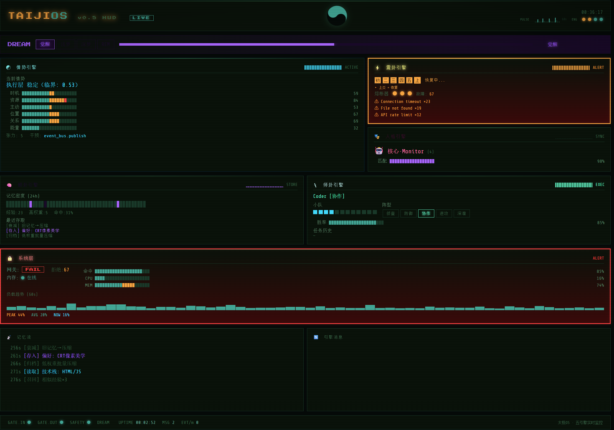

<h1 align="center">TaijiOS 太极OS</h1>

<p align="center">
  <strong>Agent said done. Where is the evidence?</strong><br>
  An evidence-first reliability runtime for AI agents: block "done" claims that have no evidence behind them, and state plainly what is still unverified.<br>
  面向 AI agent 的证据优先可靠性运行时：没有证据的"已完成"一律拦下，并写明还有哪些没有验证。
</p>

<p align="center">
  <a href="https://github.com/yangfei222666-9/taiji/actions/workflows/ci.yml"></a>
  <a href="LICENSE"></a>
</p>

---

## The problem 问题

Coding agents often close a task with "Done. Everything is ready." Sometimes the tests never ran, CI is still red, or the file was never written. TaijiOS treats every success claim as unverified until it points at evidence, and every closeout has to list what it **cannot** claim.

编码 agent 经常一句"做完了"就收工，可测试也许根本没跑、CI 还是红的、文件压根没写。TaijiOS 把每个"成功"都当作未验证，直到它给出证据；每次收尾还必须写明哪些事**不能**声称。

## 30-second example 30 秒看懂

An agent closeout, written as JSON:

```json
{
  "agent_claim": "Done. Everything is ready.",
  "success_claims": ["done", "ready"],
  "evidence": [],
  "cannot_claim": ["remote_ci_pass", "production_readiness"]
}
```

The False-Pass Gate blocks it, because nothing backs up "done":

```text
case_id=fail_unsupported_done actual=BLOCKED verification_mode=schema_only reasons=missing_passing_evidence
```

Add an evidence item with a type, a pointer and `"status": "PASS"`, keep the `cannot_claim` list, and the same closeout passes.

## Quick start 快速开始

No install, no API key, no GPU. Python 3.10 or newer.

```bash
git clone https://github.com/yangfei222666-9/taiji.git
cd taiji

# 1. False-Pass Gate self-test: 3 fixtures, 2 must be blocked and 1 must pass
python3 scripts/check_false_pass_gate.py --self-test examples/false_pass_gate/fixtures

# 2. Check evidence bytes, not just declarations (SHA256 of local files)
python3 scripts/check_false_pass_gate.py \
  --case examples/false_pass_gate/local_files/claim.json \
  --evidence-root examples/false_pass_gate/local_files/evidence

# 3. The task -> verify -> fail -> retry -> record loop
python3 examples/quickstart_minimal.py
```

Step 1 prints:

```text
case_id=fail_missing_cannot_claim actual=BLOCKED verification_mode=schema_only reasons=missing_cannot_claim expected=BLOCKED
case_id=fail_unsupported_done actual=BLOCKED verification_mode=schema_only reasons=missing_passing_evidence expected=BLOCKED
case_id=pass_with_evidence actual=PASS verification_mode=schema_only reasons=evidence_and_boundaries_present expected=PASS
self_test=PASS cases=3
```

Step 3 is a **deterministic simulation**: three synthetic tasks fail once (fixed score 0.35), pass on retry (0.90), and every step is written to `examples/quickstart_output/` as evidence, trace and event files. It shows the control flow; it calls no model and measures no real improvement.

To install the package: `pip install -e .` (the distribution is named `taijios` and imports as `aios`).

## What's here 仓库里有什么

| Part | Path | Status |
|---|---|---|
| False-Pass Gate: blocks success claims without evidence, with an optional local SHA256 check | `scripts/check_false_pass_gate.py` | verified, covered by CI tests |
| Evidence loop demo: task -> verify -> retry -> JSON evidence | `examples/quickstart_minimal.py` | verified demo (simulation) |
| Event-driven core: EventBus, scheduler, JSONL event log | `aios/core/` | verified demo |
| LLM Gateway: auth, rate limiting, provider failover, audit | `aios/gateway/` | prototype |
| Agent system: task queue, routing, lifecycle | `aios/agent_system/` | prototype |
| Safe Click: four-gate controlled click executor | `rpa_vision/` | prototype |
| HUD: live five-engine monitor | [taijios-hud.netlify.app](https://taijios-hud.netlify.app) | demo |

The full feature table, including removed modules, is in the [overview](docs/TAIJIOS_OVERVIEW.md#features-核心能力).

## What this does not claim 不声称的事

- The default gate checks declarations. It does not run the recorded command or fetch evidence. The hash mode proves that local bytes match a hash, not that their content is true.
- The quickstart is a simulation, not measured model self-healing.
- Public code and green CI here do not establish production readiness, customer adoption, or any external endorsement.

## For reviewers 审阅入口

- [Start here](docs/START_HERE_FOR_REVIEWERS.md): a 5-minute review path with exact verdicts
- [Agent Reliability proof](docs/portfolio/agent-reliability-proof.md): the PRs, commands, CI runs and limits behind each claim
- [Codex Reliability Gap Map #01](docs/research/codex-reliability-gap-map-01.md): a scoped review of 30 public coding-agent failure reports, mapped to evidence-gate patterns
- [Machine-readable proof index](docs/proof_index.json)

## Beyond the gate 更多

TaijiOS also includes a broader runtime whose five engines are named after I Ching hexagrams. The names mark each engine's responsibility boundary; they are not a mystical claim. The architecture, the Ising heartbeat experiment, the module map, configuration, private modules and the roadmap are in the **[TaijiOS overview](docs/TAIJIOS_OVERVIEW.md)**.

<p align="center">
  
</p>

## Contributing · License

See [CONTRIBUTING.md](CONTRIBUTING.md). Released under the [MIT License](LICENSE).
